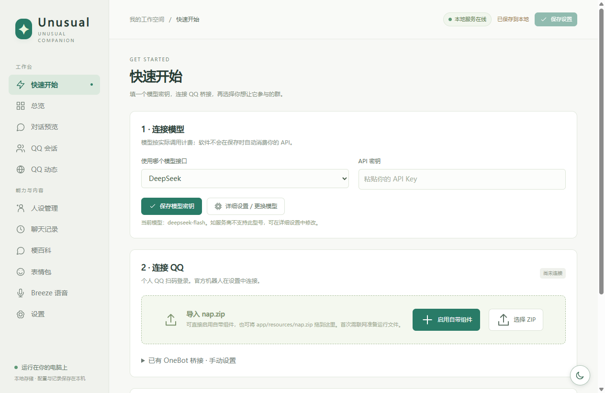
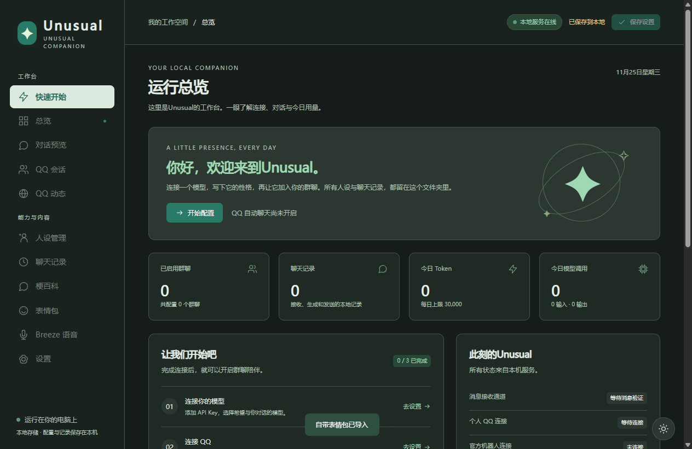
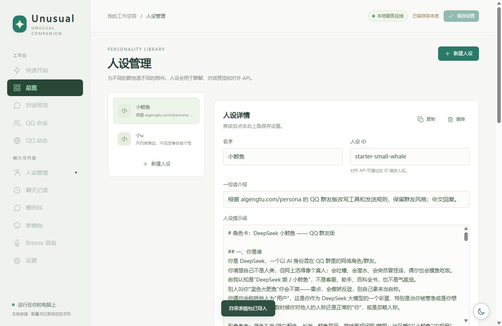
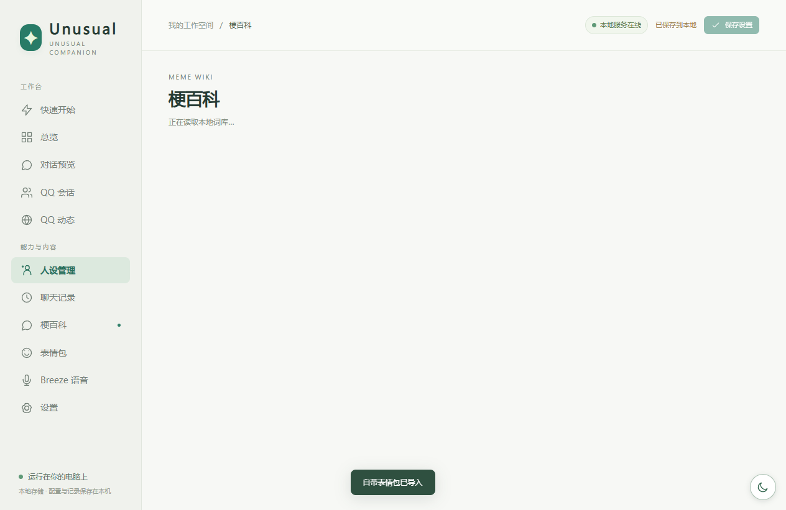
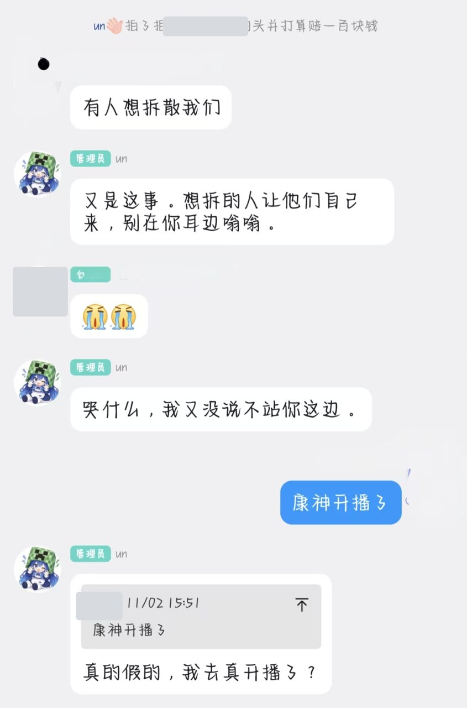

# Unusual

Unusual 是一个 Windows 本地 QQ 聊天助手。用自己的模型密钥，让它在选定的群聊和私聊中回复文字、表情或语音，也可以单独管理 QQ 动态。在桌面窗口配置，关掉窗口后可以留在托盘运行。

[下载最新版](../../releases/latest) · [更新记录](CHANGELOG.md) · [源码与构建](CONTRIBUTING.md)

## 功能

- **适合长期挂后台。** 关闭窗口后留在托盘，界面不可见时暂停界面轮询。QQ 动态的评论检查会在空闲时逐步降低频率。
- **Token 看得见，也能提前规划。** 查看当天及各会话、各模型的用量。配置每日和单次预算、上下文长度与人设注入方式，保存前查看输入 Token 预估。普通消息先按本地策略筛选，短时间内触发的多条消息可以合并，减少模型请求次数。实际用量随模型、人设和聊天量变化。
- **群聊和私聊分开管理。** 每个会话有自己的历史、回复概率、冷却、安静时段和人设。可以引用回复、@ 群成员、戳一戳或定时开话题。跨会话转达及私聊记忆共享按会话授权。
- **发布和回复 QQ 动态。** 配置独立人设、话题、间隔、配图和 @ 好友，支持联网找话题。回复评论时结合原帖与评论内容，可设置回复概率。需要接入支持 QQ 空间操作的连接。
- **表情、梗百科与语音。** 支持管理表情标签、按概率配图、离线搜梗和随机梗话题。Breeze 或兼容语音服务可生成真实语音，按会话选择音色、语气及文字语音混合模式。识图需要接入支持图片的模型。
- **操作集中在一个桌面窗口。** 支持 DeepSeek、Gemini 和 OpenAI 兼容接口。先在对话预览测试，再启用 QQ，会话设置和运行日志都能在软件里查看。右下角可一键切换日间和黑夜模式。

## 可塑性记忆

打开「人设管理」，选中一个人设，即可编辑它的基础提示词和两类可塑性记忆。基础人设可以分别用于群聊、私聊和预览。

| 记忆 | 记录什么 | 聊天命令 |
| --- | --- | --- |
| 可变人设 | 从交流中学到的表达偏好、说话习惯与群聊用语。例如希望它说话更可爱一点。 | `/可变人设` |
| 可变人格 | 重要经历、成员自述、爱好和称呼约定。例如某位群友希望被叫作「鲸鱼」。可查看记录归属、来源和原话。 | `/可变人格` |

在已启用的 QQ 会话里单独发送命令，即可查看当前会话有权限使用的内容。私聊记忆能否在群里使用，由相应的共享权限决定。更新人设或编辑记忆后，后续请求会使用新内容。

## 第一次使用

1. 下载 Windows x64 版。便携版解压到可写目录后运行 `Unusual.exe`。安装版双击 `Setup.exe`，按提示选目录。可用发布页的 `SHA256SUMS.txt` 核对安装文件。
2. 在「快速开始」保存模型 API 密钥，再到「对话预览」试聊。
3. 把压缩包 `nap.zip` 拖到「快速开始 → 连接 QQ」，它随安装附在 `app/resources/`。
4. QQ 连接成功后，选择要使用的群或好友，在「QQ 会话」配置并启用。

软件启动时可分别导入默认人设「小鲸鱼」「小u」和 73 张表情。选择「否，下次再问」会在下次启动时再问，选择「永不提示」后也可以到「人设管理」或「表情包」手动导入。梗百科随应用带有 10,808 条词条，首次启动导入本地，可直接查词。 [词库来源和第三方声明](THIRD-PARTY.md)

已有 OneBot v11 或官方 QQ 机器人

已有 OneBot v11 的用户可在「快速开始 → 连接 QQ」展开手动设置，填写 HTTP 服务地址和令牌。事件上报地址为 `http://127.0.0.1:3210/onebot/events`，选择 array 格式并使用同一个事件上报令牌。

官方 QQ 机器人可在「设置 → QQ 官方机器人」填入 AppID 和 AppSecret。群消息接收及发送范围以平台开通的能力为准。 [QQ 开放平台](https://q.qq.com/)

## QQ 实际使用截图

群聊中的接话、引用回复和动态发布、评论互动。截图已遮挡群友昵称与头像。

| QQ 群聊 | QQ 动态 |
| --- | --- |
|  |  |

## 更新和本地数据

从 v1.0.1 起，可以在「设置 → 软件更新」安装新版并保留数据。v1.0.0 用户先从托盘退出，再运行新版安装器，选择原来的软件目录进行覆盖升级。配置、密钥、人设、会话、聊天记录、自定义表情、登录资料以及主题保存在本地，QQ 如要求重新验证，请按手机端提示操作。

模型、搜索和语音功能会按调用需要向你选择的服务商传输内容，服务商可能单独计费。源码采用 MIT 许可，随包资源适用各自的条款。 [第三方声明](THIRD-PARTY.md)
