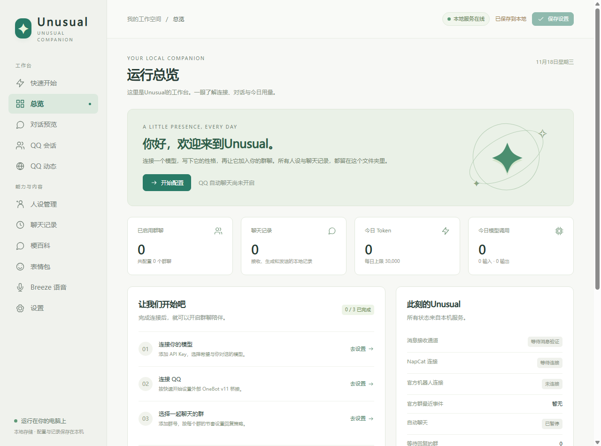

# Unusual

Unusual 是一个在 Windows 上运行的 QQ 聊天助手。它可按会话接入模型，结合近期发言判断是否该接话，也能在你设定的间隔主动开话题。桌面窗口负责配置，关闭窗口后任务继续在托盘运行。第一次打开时，人设和 QQ 会话都是空的，可以先选模型试聊，再按需要创建人设。

[下载 Windows 版](../../releases/latest) · [搭建与开发](CONTRIBUTING.md) · [更新记录](CHANGELOG.md)

## 可以做什么

| 功能 | 说明 |
| --- | --- |
| QQ 群聊与私聊 | 可对不同会话配置模型、人设、回复概率、冷却、免打扰时段和每小时上限。 |
| 上下文接话 | 可按群开启接话判断，分别调整自然参与概率和模糊消息判断概率。@、引用和真实发言者提供更明确的线索。旁观时可选轻回应。 |
| 主动发言和 QQ 空间 | 群聊可定时开话题。使用支持对应扩展的 OneBot 桥接可发布动态、配图、@ 好友并回复自己的动态评论。 |
| 人设与可塑性记忆 | 自己创建人设。可编辑表达习惯、称呼、成员事实与来源，同一会话切换人设时可以开启新上下文。 |
| 模型、图片与语音 | 支持 DeepSeek、Gemini 和 OpenAI 兼容接口。识图需要支持图片的模型，语音可使用 Breeze 或兼容语音接口。 |
| 表情、梗百科与搜索 | 按标签使用本地表情，维护本地词库，可选用 Tavily 或 SearXNG 搜索。梗库初始为空，可自行编辑或导入。 |
| 本地记录和用量 | 查聊天记录、逐条回复诊断、导出与备份。配置输入预算、每日 Token 上限与上下文长度。 |
| 本机聊天 API | 通过本机接口把模型接到自己的脚本。API 与管理界面分别鉴权。 |

## 哪些场景适合用它

- 想让每个群有自己的聊天节奏。在一个窗口管理回复策略、上下文、主动话题和用量。
- 想看清助手为什么没回。聊天历史可以追到接收、排队、判定、生成和发送各环节。
- 想随时停下来或搬走数据。后台可从托盘退出，配置和 SQLite 记录放在应用目录的 `data/` 下。
- 想控制成本和发送范围。普通消息通过条件和概率触发，连续消息可合并处理，跨会话转达和私聊记忆共享需要单独授权。

查看运行总览截图

## 第一次使用

下载 Windows x64 发行文件。**Portable.zip** 适合解压到可写目录后双击 `Unusual.exe`。**Setup.exe** 会让你选择目录，再新建 `Unusual` 文件夹。安装程序不需要管理员权限，请选择能在其中新建 Unusual 文件夹的位置。安装器会保护已存在的文件夹。安装包尚未进行 Authenticode 签名，下载后可核对 Releases 中的 `SHA256SUMS.txt`。

1. 打开「快速开始」，保存你自己的模型 API Key。先到「对话预览」发送一条测试消息，验证模型可用。
2. 创建人设是可选的。在「人设管理」新建后可填写自己的提示词，并给指定会话选用。
3. 按需选一种 QQ 接入方式，再在「QQ 会话」启用目标会话，最后打开 QQ 自动聊天总开关。

### 自带表情包

两个 Windows 发行包都包含 `app/resources/emoji-starter.zip`，无需二次下载。首次打开「表情包」时选择「是，导入」可使用全部 73 张图片。选「否」会保留未启用状态，之后可点「导入自带表情包」。已有的同名图片与标签会保留。

### 从旧版升级

- **v1.0.0 首次升级**：从托盘退出 Unusual，运行新版 Setup.exe，在目录选择框中直接选原先存放 Unusual.exe 的文件夹，确认原地升级。旧便携版也适用。
- **v1.0.1 起**：打开「设置 → 软件更新」，检查并下载更新，点「保留数据并重启更新」。安装包会核对 GitHub 的 SHA-256 摘要。更新会短暂中断聊天，完成后重新打开。
- 升级只替换发行包清单中的程序文件。人设、密钥、群与好友设置、聊天记录、记忆、个人表情、主题以及本机备份均留在原处。安装失败会回退已替换的文件。
- 外部 OneBot 的扫码登录由桥接器保存。升级期间可保持桥接器运行；官方机器人会用已保存的 AppID 和 AppSecret 重新连接。QQ 平台若要求重新验证、或密钥被撤销，仍需按平台提示处理。

### 个人 QQ 扫码登录（Windows x64）

1. 从 [v1.0.3 发布页](https://github.com/unusuai0721/Unusual/releases/tag/v1.0.3) 同时下载 Unusual 和 **Unusual-NapCat-4.18.42-Windows-x64.zip**。
2. 打开「快速开始 → 连接 QQ」，将组件 ZIP 原样拖入虚线框，也可以点「选择 ZIP」。Unusual 会校验压缩包，首次联网下载并校验约 118 MB 的 Windows 运行文件，再自动启动 NapCat。使用手机 QQ 扫描窗口中的二维码，确认登录后点「选择聊天的群」。
3. 已有相同版本完整 `NapCat.Shell.Windows.Node.zip` 的用户可以直接拖入进行离线安装。已安装的组件位于应用的 `components/`，登录资料在 `data/`。应用更新保留两者。断开会保留登录，解绑会清除本软件的账号登录资料。

### 已有外部 OneBot v11

在你另行安装的 OneBot 桥接器中完成账号登录。HTTP 服务可只监听本机，例如 `http://127.0.0.1:3000`。把地址及访问令牌填进 Unusual「快速开始」。在桥接器中新建 HTTP 事件上报，目标为 `http://127.0.0.1:3210/onebot/events`，选择 **array** 消息格式，使用 Unusual 中的事件上报令牌。若桥接器使用不同的签名密钥，在 Unusual 设置中填写同一密钥。保存并测试，再导入群或添加好友。好友列表、语音和 QQ 空间扩展取决于桥接器实现。 [NapCat 上游](https://github.com/NapNeko/NapCatQQ)

### 官方 QQ 机器人

在 QQ 开放平台注册机器人，在 Unusual「设置 → QQ 官方机器人」填写 AppID 与 AppSecret。连接后，按开放平台的权限规则将机器人添加到允许的群，从群内触发一次事件，然后在软件中添加发现的会话。群聊触发与发送能力受官方接口权限约束。 [QQ 开放平台](https://q.qq.com/)

### 本地数据与模型服务

软件默认只在本机监听。打开模型、语音或搜索功能后，调用所需的消息上下文、图片、文本或查询会送往你所选的服务。服务商可能按调用计费。若 QQ 未连接但只想测试模型，使用对话预览。

查看或修改源码时，从 [源码与构建说明](CONTRIBUTING.md) 开始。卸载时先从托盘退出，备份 `data/`，再移除应用目录。

本项目源码使用 MIT 许可，随包的 Node.js 与 Electron 及改编的梗百科逻辑适用各自的许可。详见 [LICENSE](LICENSE) 和 [第三方声明](THIRD-PARTY.md)。
